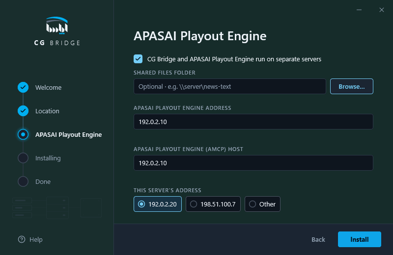

<!-- install-quick-guide -->
# راهنمای نصب APASAI CG

نسخهٔ `1.2.1` · نصب Bridge، اتصال اپراتور و آزمون اولین قالب

## آماده‌سازی و نصب

### پیش از شروع

ویندوز ۱۰ یا ۱۱ نسخهٔ ۶۴ بیتی، شبکهٔ مشترک، آدرس Playout و گذرواژهٔ حساب `cg-admin` را آماده کنید. پروانهٔ Playout باید CG را پوشش دهد. حداقل نسخهٔ Playout برای اتصال `2.9.0` است. پیش‌نمایش ورودی زنده با Playout `2.18.17` بررسی شده است.

**برای ارتقا از `1.1.0` یا `1.2.0`** ابتدا کار Designer را ذخیره کنید و خروج گرافیک‌ها از آنتن را با اپراتور هماهنگ کنید. نصب‌کننده‌های همین بسته را روی نسخهٔ موجود اجرا کنید تا تنظیمات حفظ شوند.

### نصب به این ترتیب

1. **CG Bridge** روی سرور Bridge با دسترسی Administrator. فایل `CG-Bridge_1.2.1_x64-setup.exe` را اجرا کنید.
2. **CG Control** روی رایانهٔ اپراتور. فایل `CG-Control_1.2.1_x64-setup.exe` را اجرا کنید.
3. **CG Designer** روی رایانهٔ طراح. فایل `CG-Designer_1.2.1_x64-setup.exe` را اجرا کنید.

برای وارسی فایل‌ها از `SHA256SUMS.txt` استفاده کنید. نسخهٔ نصبی امضای دیجیتال ندارد و ممکن است ویندوز هشدار نمایش دهد.

### تنظیم CG Bridge

- **روی رایانهٔ Playout** گزینهٔ `CG Bridge and APASAI Playout Engine run on separate servers` را خالی بگذارید.
- **روی سرور جدا** همین گزینه را تیک بزنید. در `APASAI PLAYOUT ENGINE ADDRESS` آدرس موتور اصلی را وارد کنید و در `THIS SERVER'S ADDRESS`، IP ثابت سرور Bridge را انتخاب کنید.
- **برای فایل‌های مشترک** مسیر `SHARED FILES FOLDER` را از دید سرور Bridge وارد کنید. در مسیر UNC، هویت سرویس CG Bridge باید در هر دو بخش `Sharing` و `Security` مجوز `Read` داشته باشد.
- پس از `Finish`، در `http://127.0.0.1:5280/health` روی سرور Bridge، نسخهٔ `1.2.1` را بررسی کنید.

## اتصال CG Control

### اولین ورود

1. در `Set up CG Control`، آدرس موتور را در `Host` بخش `APASAI Playout Engine address` وارد کنید. `Port` را برای درگاه پیش‌فرض خالی بگذارید.
2. اگر Bridge روی همان رایانهٔ Playout است، `CG Bridge address` را خالی بگذارید. برای سرور جدا، IP سرور Bridge را وارد کنید. `Connect` را بزنید.
3. با `cg-admin` و گذرواژهٔ «حساب داخلی CG Control» در تنظیمات Playout، `Sign in` را بزنید. اگر سرور Bridge در انتظار تأیید است، مدیر در «تنظیمات ← اتصال به CG Control» دکمهٔ «تأیید» را بزند.
4. کانال‌ها را انتخاب کنید و `Use this channel` یا `Use these channels` را بزنید. اگر ورود خودِ Bridge درخواست شد، `Sign in CG Bridge…` را انتخاب کنید.

### ایستگاه دارای موتور پشتیبان

Bridge را روی یک سرور جدا، کنار هر دو موتور نصب کنید و در نصب Playout روی هر دو موتور تیک «CG Bridge هم نصب شود» را بردارید.

در `SETTINGS` ← `Connection`، با `Add backup` آدرس موتور پشتیبان را وارد کنید و `Add to draft` و `Apply servers` را بزنید. ورود Bridge و «تأیید» دسترسی را روی همان موتور انجام دهید. از Playout `2.9.5` به بعد، Bridge کانال آینه را از موتور پشتیبان می‌خواند. در نسخه‌های قدیمی‌تر شمارهٔ کانال آینه را وارد کنید و `Save backup channels` را بزنید. پیش از پخش، سلامت هر دو موتور و نگاشت کانال‌ها را در نوار وضعیت بررسی کنید.

## آزمون و رفع مشکل

### اولین قالب را آزمایش کنید

1. در Designer پروژه را باز کنید و با `Export (.vcg)` از کامپوزیشن خروجی بگیرید.
2. روی **کانال آزمایشی خارج از پخش** در CG Control، روی ردیف خالی `LOAD` و سپس `Import a .vcg` را بزنید. قالب را با `ON PVW` در پیش‌نمایش بررسی کنید.
3. روی همان کانال آزمایشی `PLAY` را بزنید و خروجی PROGRAM را ببینید. برای آزمون ویرایش، در Inspector مقداری را عوض کنید و با `Update on air` روی PROGRAM اعمال کنید. در پایان `CLEAR` را بزنید.

### اگر اتصال برقرار نشد

- **Bridge پاسخ نمی‌دهد.** در `SETTINGS` ← `Connection`، آدرس‌های Playout و Bridge را بررسی کنید و `Check` را بزنید.
- **صفحهٔ ورود به ایستگاه دیگری باز شده.** با `Set up again` آدرس درست را وارد کنید.
- **نسخه‌ها متفاوت‌اند.** CG Bridge، CG Control و CG Designer را از یک بسته نصب کنید.
- **مسیر اشتراکی باز نمی‌شود.** دسترسی مسیر و مجوز سرویس CG Bridge را از سرور Bridge بررسی کنید.
- **گزارش مشکل.** فایل `LOG` ← `Download logs` را با زمان، شمارهٔ کانال و لایه و تصویر صفحه بفرستید.
