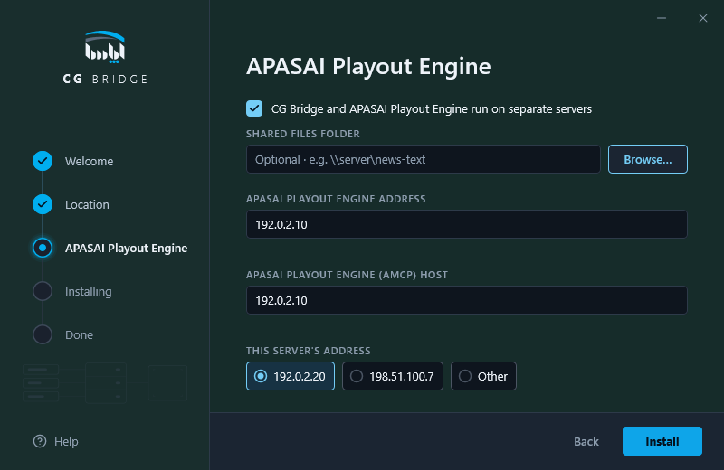

<!-- install-quick-guide -->
# راهنمای نصب APASAI CG

نسخهٔ `1.2.11` · نصب Bridge، اتصال CG Control و آزمون چیدمان زنده

## آماده‌سازی و نصب

### پیش از شروع

ویندوز ۱۰ یا ۱۱ نسخهٔ ۶۴ بیتی، آدرس Playout و گذرواژهٔ حساب `cg-admin` را آماده کنید. پروانهٔ Playout باید CG را پوشش دهد. حداقل نسخهٔ Playout برای اتصال `2.9.0` است.

**برای ارتقا از `1.1.0` یا نسخه‌های `1.2.0` تا `1.2.10`** پروژهٔ Designer را ذخیره کنید و خروج گرافیک‌ها از آنتن را هماهنگ کنید. نصب‌کننده‌ها را روی نسخهٔ موجود اجرا کنید تا تنظیمات حفظ شوند.

**اگر قبلاً `1.2.11` نصب شده است، باز هم فایل‌های همین بستهٔ تازه را نصب کنید.** چند بیلد داخلی شمارهٔ یکسان دارند؛ Bridge و Control را از یک پوشهٔ بیلد بردارید و با فایل‌های پوشهٔ قدیمی مخلوط نکنید.

### نصب به این ترتیب

1. روی سرور Playout، فایل `CG-Bridge_1.2.11_x64-setup.exe` را با دسترسی Administrator اجرا کنید. در ایستگاه A/B، Bridge جدید همین بسته را روی هر دو سرور A و B نصب کنید. اگر ایستگاه Bridge جدا دارد، آن را هم با همین بسته به‌روز کنید.
2. روی رایانهٔ اپراتور، `CG-Control_1.2.11_x64-setup.exe` را نصب کنید.
3. روی رایانهٔ طراح، `CG-Designer_1.2.11_x64-setup.exe` را نصب کنید.

برای وارسی فایل‌های بسته از `SHA256SUMS.txt` استفاده کنید.

### تنظیم CG Bridge

- **روی سرور Playout** گزینهٔ `CG Bridge and APASAI Playout Engine run on separate servers` را خالی بگذارید.
- **روی سرور جدا** همین گزینه را تیک بزنید. در `APASAI PLAYOUT ENGINE ADDRESS` آدرس موتور اصلی را وارد کنید و در `THIS SERVER'S ADDRESS`، IP ثابت سرور Bridge را انتخاب کنید.
- در `SHARED FILES FOLDER` مسیر را از دید سرور Bridge وارد کنید، مثلاً `C:\CG-Shared`.
- پس از `Finish`، روی سرور Bridge آدرس `http://127.0.0.1:5280/health` را باز کنید و نسخهٔ `1.2.11` را بررسی کنید.

## اتصال CG Control

### اولین ورود

1. در `Set up CG Control`، آدرس موتور را در `Host` بخش `APASAI Playout Engine address` وارد کنید. برای درگاه پیش‌فرض، `Port` را خالی بگذارید.
2. اگر Bridge روی همان سرور Playout است، `CG Bridge address` را خالی بگذارید. برای سرور جدا، IP سرور Bridge را وارد کنید. `Connect` را بزنید.
3. با `cg-admin` و گذرواژهٔ «حساب داخلی CG Control» در Playout، `Sign in` را بزنید. در صورت درخواست تأیید، مدیر در «تنظیمات ← اتصال به CG Control» دکمهٔ «تأیید» را بزند.
4. کانال‌ها را با `Use this channel` یا `Use these channels` انتخاب کنید. اگر ورود Bridge درخواست شد، `Sign in CG Bridge…` را بزنید.

### ایستگاه دارای موتور پشتیبان

Bridge موجود روی A و B و برنامهٔ CG Control باید از همین بستهٔ تازه باشند. نصب یک Bridge قدیمی با شمارهٔ یکسان `1.2.11` کافی نیست. پیش از نصب، گرافیک‌ها را از آنتن خارج کنید؛ نصب این بسته تنظیمات ذخیره‌شده را حفظ می‌کند.

در `SETTINGS` ← `Connection`، با `Add backup` آدرس پشتیبان را وارد کنید و `Add to draft` را بزنید. در انتهای `Advanced` روی `Apply servers` بزنید. ورود Bridge و «تأیید» را روی پشتیبان انجام دهید. از Playout `2.9.5` نگاشت کانال آینه خودکار است. اگر سرور B نگاشت خودکار اعلام نکرد، کانال را از فهرست رزرو انتخاب کنید و `Save backup channels` را بزنید.

## آزمون و رفع مشکل

### ساخت و پخش Live layout

1. در **کانال آزمایشی خارج از پخش**، `Layers` ← `New live layout` را باز کنید. در `Arrange` نسبت پریست سه‌قاب را `3:4` و Fit را `Crop edges` بگذارید. برای همان ورودی در پریست تک‌قاب، `16:9` و `Fit whole picture` را انتخاب کنید.
2. در `Advanced plate controls` ← `This preset` می‌توانید نسبت و Fit قاب را جداگانه تنظیم کنید. در `Border` رنگ و ضخامت را تعیین کنید. در `Choose a source` ورودی یا مدیا را انتخاب کنید. در Playout سازگار، پیش‌نمایش مدیا از فایل یا Proxy پخش می‌شود و Play، Pause، Stop، نوار زمان و شنیدن اختیاری صدا دارد. صدا در شروع خاموش است. `Save layout` را بزنید.
3. در **Live layer** خالی، با `LOAD` و `Load onto Live layer …` چیدمان را بار کنید. `ON PVW` و سپس `PLAY` پنل PVW را بزنید. در صورت دیر رسیدن تصویر زنده، PVW می‌تواند تصویر Inspector یا پوستر مدیا را موقتاً نشان دهد.
4. روی **خود ردیف** `PLAY` را بزنید. `PROGRAM`، `Focus`، `Return to …` و `Update on air` را بررسی کنید. اگر موتور پشتیبان دارید، در `PROGRAM` گزینهٔ `All` یا `B` را بزنید و نمایش مدیا و افکت‌ها را بررسی کنید. در پایان `CLEAR` را بزنید.

دکمه‌های پریست و Focus در Inspector فقط PVW را تغییر می‌دهند. دکمه‌های خود ردیف برای PGM هستند؛ پیش از پخش، پریست شروع را مشخص می‌کنند. برای بررسی رزرو، ورودی زنده، خروجی لیست پخش و هر دو مدیا را در A و B کنترل کنید. پررنگ‌شدن کادر نشان A یا B کنار منبع، سرورِ تصویر دریافت‌شده را مشخص می‌کند و رنگ سبز یا قرمز همان وضعیت دسترسی است.

برای قالب‌های Designer، `Export (.vcg)` و سپس `Import a .vcg` در پنجرهٔ `LOAD` را بزنید.

### اگر اتصال برقرار نشد

- در `SETTINGS` ← `Connection`، `Check` و برای ایستگاه دیگر `Set up again` را بزنید.
- در `Shared files`، `Check access` را بزنید. هویت سرویس CG Bridge برای پوشهٔ محلی به `Read & execute` و برای UNC به `Read` در `Sharing` و `Security` نیاز دارد.
- گزارش خطا از `LOG` ← `Download logs` دریافت می‌شود.
