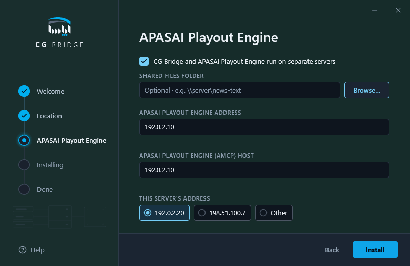

<!-- install-quick-guide -->
# راهنمای نصب APASAI CG

نسخهٔ `1.2.6` · نصب Bridge، اتصال CG Control و آزمون Live layout

## آماده‌سازی و نصب

### پیش از شروع

ویندوز ۱۰ یا ۱۱ نسخهٔ ۶۴ بیتی، آدرس Playout و گذرواژهٔ حساب `cg-admin` را آماده کنید. پروانهٔ Playout باید CG را پوشش دهد. حداقل نسخهٔ Playout برای اتصال `2.9.0` است.

**برای ارتقا از `1.1.0` یا نسخه‌های `1.2.0` تا `1.2.5`** پروژهٔ Designer را ذخیره کنید و خروج گرافیک‌ها از آنتن را هماهنگ کنید. نصب‌کننده‌ها را روی نسخهٔ موجود اجرا کنید تا تنظیمات حفظ شوند.

### نصب به این ترتیب

1. روی سرور Playout، فایل `CG-Bridge_1.2.6_x64-setup.exe` را با دسترسی Administrator اجرا کنید. اگر ایستگاه Bridge جدا دارد، همین نسخه را روی سرور Bridge نصب کنید.
2. روی رایانهٔ اپراتور، `CG-Control_1.2.6_x64-setup.exe` را نصب کنید.
3. روی رایانهٔ طراح، `CG-Designer_1.2.6_x64-setup.exe` را نصب کنید.

برای وارسی فایل‌های بسته از `SHA256SUMS.txt` استفاده کنید.

### تنظیم CG Bridge

- **روی سرور Playout** گزینهٔ `CG Bridge and APASAI Playout Engine run on separate servers` را خالی بگذارید.
- **روی سرور جدا** همین گزینه را تیک بزنید. در `APASAI PLAYOUT ENGINE ADDRESS` آدرس موتور اصلی را وارد کنید و در `THIS SERVER'S ADDRESS`، IP ثابت سرور Bridge را انتخاب کنید.
- در `SHARED FILES FOLDER` مسیر را از دید سرور Bridge وارد کنید. برای مسیر UNC، هویت سرویس CG Bridge در هر دو بخش `Sharing` و `Security` به مجوز `Read` نیاز دارد.
- پس از `Finish`، روی سرور Bridge آدرس `http://127.0.0.1:5280/health` را باز کنید و نسخهٔ `1.2.6` را بررسی کنید.

## اتصال CG Control

### اولین ورود

1. در `Set up CG Control`، آدرس موتور را در `Host` بخش `APASAI Playout Engine address` وارد کنید. برای درگاه پیش‌فرض، `Port` را خالی بگذارید.
2. اگر Bridge روی همان سرور Playout است، `CG Bridge address` را خالی بگذارید. برای سرور جدا، IP سرور Bridge را وارد کنید. `Connect` را بزنید.
3. با `cg-admin` و گذرواژهٔ «حساب داخلی CG Control» در Playout، `Sign in` را بزنید. در صورت درخواست تأیید، مدیر در «تنظیمات ← اتصال به CG Control» دکمهٔ «تأیید» را بزند.
4. کانال‌ها را با `Use this channel` یا `Use these channels` انتخاب کنید. اگر ورود Bridge درخواست شد، `Sign in CG Bridge…` را بزنید.

### ایستگاه دارای موتور پشتیبان

Bridge را روی یک سرور جدا نصب کنید. هنگام نصب Playout روی هر دو موتور، تیک «CG Bridge هم نصب شود» را بردارید.

در `SETTINGS` ← `Connection`، با `Add backup` آدرس پشتیبان را وارد کنید و `Add to draft` و `Apply servers` را بزنید. ورود Bridge و «تأیید» را روی پشتیبان انجام دهید. از Playout `2.9.5` نگاشت کانال آینه خودکار است. در نسخه‌های قدیمی‌تر آن را با `Save backup channels` ثبت کنید. سلامت موتورها و نگاشت کانال‌ها را بررسی کنید.

## آزمون و رفع مشکل

### ساخت و پخش Live layout

1. در **کانال آزمایشی خارج از پخش**، `Layers` ← `New live layout` را باز کنید. ورودی و عنوان قاب‌ها، اعضای پریست (`In preset`) و چینش (`Arrange`) را تعیین کنید و `Save layout` را بزنید.
2. در ردیف خالی **Live layer**، با `LOAD` و `Load onto Live layer …` چیدمان را بار کنید. `ON PVW` را بزنید و با `PLAY` پنل PVW پیش‌نمایش را اجرا کنید.
3. روی **خود ردیف** `PLAY` را بزنید و `PROGRAM` را بررسی کنید. در `Focus · PVW` یا `Focus · PGM` شمارهٔ قاب و پیکان `Return to …` را امتحان کنید. با `Update on air` تغییر Inspector را اعمال کنید و در پایان `CLEAR` را بزنید.

برای قالب‌های Designer، `Export (.vcg)` را در Designer و سپس `Import a .vcg` را در پنجرهٔ `LOAD` بزنید.

### اگر اتصال برقرار نشد

- در `SETTINGS` ← `Connection`، آدرس‌ها را بررسی کنید و `Check` را بزنید. اگر ایستگاه اشتباه است، `Set up again` را بزنید.
- برای گزارش مشکل، فایل `LOG` ← `Download logs` را با زمان، کانال و لایه بفرستید.
